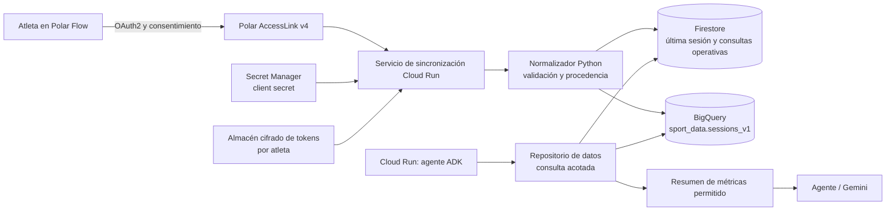

# Arquitectura de conexión y consulta de datos

## Decisión y estado implementado

El servicio de Cloud Run no debe consultar Polar ni almacenar tokens dentro del
agente durante una conversación. La ruta propuesta separa la captura,
normalización y consulta:

1. **Polar AccessLink Dynamic API v4** es el origen de sesiones, después del
   consentimiento OAuth2 de cada atleta.
2. **Firestore (modo nativo)** conserva el resumen operativo que el agente
   necesita para preguntas como «mi última sesión». Firestore usa colecciones y
   documentos; no usa tablas ni filas.
3. **BigQuery** conserva la tabla histórica analítica para comparaciones,
   tendencias y evaluación. No es la fuente de una respuesta interactiva
   simple salvo que exista un motivo analítico concreto.
4. Un repositorio Python determinista consulta el almacén autorizado y entrega
   al agente sólo métricas permitidas. El LLM nunca genera SQL ni recibe tokens,
   muestras crudas de frecuencia cardiaca o payloads OAuth.



El servicio de sincronización es un límite de seguridad: gestiona OAuth,
renovación, reintentos, límites de la API y normalización. El servicio del
agente sólo lee datos ya autorizados para el sujeto autenticado.

El **29 de octubre de 2026** se aprovisionó la base Firestore Native por
Terraform en `polar-verity-robertmx23-2026`, ubicación inmutable
`us-central1`. Se validó una carga cloud de cinco sesiones AccessLink v3 ya
autorizadas: los cinco documentos fueron leídos después de dos *upserts* por
ID estable, conservaron 25 períodos de zona y las cinco sesiones marcaron su
cobertura como `partial`. La base no contiene payloads crudos de Polar ni se
crearon claves de cuentas de servicio.

## Contrato implementado

La primera parte del diseño ya está codificada y no requiere una cuenta cloud:

| Pieza | Archivo | Responsabilidad |
|---|---|---|
| Proyección de Polar Dynamic v4 | `src/polar_assistant/application/curated_sessions.py` | Acepta únicamente `identifier.id`, inicio, duración, referencia de deporte, FC media/máxima, carga, distancia, calorías, procedencia y zonas. Ignora los demás campos del proveedor. |
| Registro curado | `CuratedTrainingSession` | Genera `ses_<uuid>` estable a partir de sujeto interno y sesión Polar, por lo que reintentar una sincronización hace *upsert* del mismo registro. |
| Adaptadores de escritura | `src/polar_assistant/infrastructure/curated_session_store.py` | Escribe el mismo contrato a Firestore o a una fila de BigQuery a través de un cliente inyectado. |
| Tool del agente | `sport_assistant_agent/curated_data_tools.py` | Obtiene el sujeto desde `authenticated_subject_id` en estado autenticado; no acepta un ID indicado por el chat. |

Los campos de alto riesgo o no necesarios se descartan antes de persistir:
`note`, coordenadas, muestras de señal, perfil físico, token OAuth y el JSON
original. El contrato marca la sesión como `validated` sólo cuando existen FC
media y máxima; de otro modo queda `summary_only`.

### Lista exacta de valores consultables

| Grupo | Valores curados |
|---|---|
| Identidad y procedencia | `session_id` interno, `provider`, `provider_session_id`, `source_created_at`, `source_modified_at`, `ingested_at`, `schema_version`, `data_quality`. |
| Sesión | `started_at`, `duration_seconds`, `sport_reference_id`. |
| Métricas resumidas | `heart_rate_average_bpm`, `heart_rate_maximum_bpm`, `training_load`, `distance_meters`, `calories`. |
| Periodos de zona | Por cada zona: `zone_type`, `zone_index` cuando el proveedor lo entrega, límites inferior/superior, `duration_seconds`, distancia y carga muscular cuando apliquen. La sesión también incluye duración total, porcentaje de cobertura y calidad (`complete`, `partial` o `unavailable`) de zonas de FC. |

En Dynamic API v4 se solicita `features=zones`. Su campo `inZone` representa el
tiempo acumulado de la zona en milisegundos y se guarda como
`duration_seconds`. Es una duración agregada, no la marca de inicio y fin de
cada tramo ni la serie de pulso.

El repositorio técnico `FirestoreCuratedSessionRepository` ya consulta una
colección delimitada por sujeto y valida cada documento de vuelta contra
`CuratedTrainingSession`. La lectura cloud con ADC confirmó los cinco
documentos, orden descendente por `started_at` y zonas presentes. La siguiente
revisión de QA compone esa lectura para el sujeto técnico
`ath_local_smoke_2026`: un middleware reemplaza el `userId` controlado por el
navegador por un hash opaco del encabezado IAP antes de que ADK abra la sesión.
El agente recibe sólo el sujeto técnico configurado por el servidor. Esto no
es un vínculo de producto IAP/OAuth a una persona ni una solución
multiusuario; el sincronizador cloud y el consentimiento siguen pendientes.

### Verificación con la autorización existente

La cuenta configurada actualmente usa el flujo AccessLink v3, no Dynamic API
v4. Se implementó una compatibilidad v3 para migrar sus ejercicios al mismo
contrato sin perder las zonas. `scripts/polar_v3_curated_smoke.py` consulta en
modo de sólo lectura, normaliza cada ejercicio y repite el *upsert* en memoria.
La prueba local confirmó cinco registros curados, cinco registros después de
los reintentos y cinco con periodos de zona. La prueba cloud equivalente se
ejecuta con `scripts/firestore_curated_smoke.py`: escribe y lee los cinco
documentos desde Firestore mediante ADC, sin persistir el JSON crudo de Polar.
BigQuery no se aprovisionó.

## Estado del repositorio y del despliegue actual

| Área | Estado actual | Implicación |
|---|---|---|
| Adaptador Polar | Existe `AccessLinkExerciseRepository` para el endpoint histórico v3 y un flujo OAuth local. | Es una base de desarrollo; no hay sincronización cloud ni token persistente por atleta. |
| Cloud Run | `polar-sport-assistant` usa la cuenta `polar-sport-runtime` y ADC para Vertex AI y Firestore. | No usa `GOOGLE_API_KEY`. La nueva revisión de QA consulta sólo el fixture técnico de Firestore tras el enlace IAP; no consulta datos personales. |
| Firestore | Base Native `(default)` en `us-central1`; cuenta `polar-sport-sync` con escritura y runtime con lectura. | Cinco documentos curados de prueba están verificados bajo el sujeto técnico. Aún no existe mapeo IAP/OAuth a sujeto ni sincronizador desplegado. |
| Datos presentados por la URL | Si no hay FIT montado autorizado, crea dos sesiones `synthetic_cloud_demo`; para “última sesión” u “histórico” la revisión QA consulta el fixture curado tras IAP. | La respuesta Firestore se etiqueta como QA y no representa una sesión personal. |
| Persistencia actual | Las sesiones ADK viven en SQLite bajo `/tmp/polar-adk`. | Se pierden al reemplazar la instancia; no son una base de telemetría. |

La captura actual es coherente con este estado: muestra `Fuente:
synthetic_cloud_demo`. Antes de añadir una conexión real, no debe cambiarse esa
etiqueta ni atribuirse la demo a una persona.

## Comparación de las opciones

| Opción | Función adecuada | Ventajas | Límite | Decisión |
|---|---|---|---|---|
| Consulta de Polar durante el chat | Ninguna como ruta normal | Datos recientes | Depende de OAuth, disponibilidad y límites de proveedor; expone la conversación a errores de red. | No usar para cada mensaje. |
| Firestore | Última sesión, lista corta y estado operativo por atleta | Baja latencia, estructura por documento y control de acceso por aplicación. | No proporciona una tabla SQL para analítica amplia. | Almacén primario del agente. |
| BigQuery | Historial, comparaciones en periodos y evaluación | Tabla SQL, particiones y agregaciones escalables. | Una consulta requiere job y no sustituye un índice operativo de baja latencia. | Espejo analítico, activado después de Firestore. |
| Firebase Realtime Database | Eventos simples en tiempo real | Sincronización de clientes. | No aporta una tabla analítica ni mejora este caso frente a Firestore. | No se incorpora en la primera versión. |

## Modelo mínimo de datos

El identificador del sujeto es un identificador interno opaco. No se usa el
correo de Google ni el `x_user_id` de Polar como clave de lectura del agente.
La relación con los identificadores externos se mantiene sólo en el servicio de
sincronización.

### Firestore: documento operativo

Ruta propuesta: `athletes/{subject_id}/sessions/{session_id}`.

```json
{
  "subject_id": "ath_01H...",
  "session_id": "ses_<uuid-estable>",
  "provider": "polar_accesslink_v4",
  "provider_session_id": "id-opaco-polar",
  "started_at": "2026-10-29T12:00:00Z",
  "sport_reference_id": "TREADMILL_RUNNING",
  "duration_seconds": 2400,
  "heart_rate_average_bpm": 141,
  "heart_rate_maximum_bpm": 164,
  "zone_periods": [{"zone_type": "ZONE_TYPE_HEART_RATE", "zone_index": 1, "lower_limit": 110, "higher_limit": 128, "duration_seconds": 840}],
  "heart_rate_zone_coverage_percent": 95.0,
  "heart_rate_zone_duration_quality": "partial",
  "data_quality": "validated",
  "ingested_at": "2026-10-29T12:03:14Z",
  "schema_version": "1.0"
}
```

La consulta de última sesión se limita al sujeto autenticado, ordenada por
`started_at` y con límite uno. Las muestras crudas de pulso, token OAuth,
secreto de cliente, dirección de callback y payload original no forman parte
del documento que consulta el agente.

### BigQuery: tabla histórica

Dataset propuesto: `sport_data`; tabla: `sessions_v1`.

```sql
CREATE TABLE `PROJECT_ID.sport_data.sessions_v1` (
  subject_id STRING NOT NULL,
  session_id STRING NOT NULL,
  started_at TIMESTAMP NOT NULL,
  sport STRING,
  duration_seconds INT64,
  mean_heart_rate_bpm INT64,
  max_heart_rate_bpm INT64,
  cardiac_drift_pct FLOAT64,
  data_quality STRING NOT NULL,
  source STRING NOT NULL,
  ingested_at TIMESTAMP NOT NULL,
  schema_version STRING NOT NULL
)
PARTITION BY DATE(started_at)
CLUSTER BY subject_id, sport;
```

El repositorio usa una consulta parametrizada con un identificador de sujeto
obtenido de la sesión autenticada. No concatena texto del usuario ni permite
elegir una tabla:

```sql
SELECT session_id, started_at, sport, duration_seconds,
       mean_heart_rate_bpm, max_heart_rate_bpm, cardiac_drift_pct,
       data_quality, source
FROM `PROJECT_ID.sport_data.sessions_v1`
WHERE subject_id = @subject_id
  AND started_at >= @from_time
ORDER BY started_at DESC
LIMIT @limit;
```

## Identidad, secretos y acceso

| Recurso | Identidad o ubicación | Regla |
|---|---|---|
| Cliente OAuth de Polar | Secret Manager | El `client_secret` se lee sólo durante autorización, renovación o sincronización. Nunca se sube a Git ni aparece en ADK state. |
| Token por atleta | Almacén cifrado separado, con referencia opaca desde el perfil | Sólo el servicio de sincronización puede leerlo; el agente no tiene ese permiso. |
| Firestore | Cuenta de servicio de lectura del agente, con el mínimo alcance | El acceso se filtra por `subject_id` autenticado y no por una entrada libre del chat. |
| BigQuery | Cuenta de servicio de analítica/repository con permisos sobre el dataset, no sobre todo el proyecto | Sólo consultas parametrizadas y columnas autorizadas. |
| Vertex AI | `polar-sport-runtime` mediante ADC | Se conserva la configuración actual; no se añade una API key de Gemini. |

La cuenta actual `polar-sport-runtime` no debe recibir todos estos permisos por
comodidad. Se crean cuentas separadas para sincronización y para lectura
analítica si se aprueba el diseño, con permisos mínimos sobre cada recurso.

## Plan de implementación

**Prioridad actual:** cerrar y evidenciar el recorrido local AccessLink v3 →
contrato curado → Firestore para el sujeto técnico de prueba. La identidad IAP,
OAuth cloud multiusuario y la composición en Cloud Run son la entrega posterior.

| Fase | Entregable verificable | No se hace todavía |
|---|---|---|
| 0. Gobierno | Consentimiento, sujeto interno, retención y lista de métricas permitidas. | Importar sesiones personales. |
| 1. Lectura operativa | Firestore Native, contrato `CuratedTrainingSession`, carga verificada de cinco documentos y permisos mínimos por cuenta de servicio. | LLM con acceso directo a Firestore. |
| 2. Polar | Callback OAuth cloud, secreto en Secret Manager y sincronizador que normaliza una sesión v4. | Guardar tokens en `.env`, Firestore o BigQuery. |
| 3. Histórico | Dataset BigQuery, tabla particionada, carga desde el normalizador y prueba de consulta parametrizada. | SQL generado por el modelo. |
| 4. Agente y operación | Sustituir la fuente demo por el repositorio, trazabilidad de fuente y despliegue de Cloud Run. | Mostrar datos si no hay consentimiento, calidad válida o pertenencia al sujeto. |

## Fuentes técnicas

- Polar describe Dynamic API v4, registro del cliente, consentimiento OAuth2,
  renovación de tokens y límites por cliente: <https://www.polar.com/polar-api-v4/>.
- El modelo de Firestore usa colecciones y documentos: <https://firebase.google.com/docs/firestore/data-model>.
- BigQuery permite parámetros de consulta y evita usar valores de parámetro como
  SQL concatenado: <https://cloud.google.com/bigquery/docs/parameterized-queries>.
- Cloud Run entrega credenciales de aplicación a través de la cuenta de servicio
  adjunta: <https://cloud.google.com/run/docs/securing/service-identity>.
