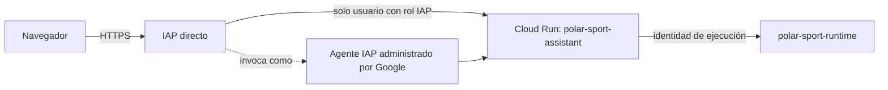

# IAP directo para Cloud Run

## Propósito

El acceso web del asistente se protege con **Identity-Aware Proxy (IAP) directo
en Cloud Run**. La solución admite inicio de sesión de cuentas de Google y no
requiere balanceador, IP pública adicional, DNS ni certificado propio para
proteger la URL administrada `run.app`.

La petición anónima nunca llega al contenedor. IAP inicia la autenticación de
Google, evalúa `roles/iap.httpsResourceAccessor` y después usa su agente
administrado `service-PROJECT_NUMBER@gcp-sa-iap.iam.gserviceaccount.com`, que
es el único principal de servicio con `roles/run.invoker`.

## Recursos declarados

El módulo principal crea o mantiene:

| Recurso | Finalidad |
|---|---|
| `iap.googleapis.com` | API que activa IAP. |
| `google_cloud_run_v2_service.iap_enabled` | Protege todas las rutas, incluida la URL `run.app`. |
| `google_cloud_run_v2_service_iam_member.iap_invoker` | Permite al agente administrado IAP invocar Cloud Run. |
| `google_iap_web_cloud_run_service_iam_binding` | Lista cerrada de personas o grupos que pueden iniciar sesión. |

`service_invokers` debe permanecer vacío. No se permiten `allUsers` ni
`allAuthenticatedUsers` en Cloud Run o IAP.

## Alta inicial del cliente OAuth

Un proyecto sin organización de Google Workspace requiere un cliente OAuth
externo para permitir cuentas Gmail u otras cuentas fuera de una organización.
Google exige crear ese primer cliente desde **Google Auth Platform**; no se
puede crear de forma programática. Este paso entrega un `client_secret`, por
lo que el valor sólo se introduce en la configuración de IAP de Google y nunca
se guarda en Git, `terraform.tfvars`, el estado Terraform ni archivos del
proyecto.

En la consola de Google Cloud:

1. Abrir **Google Auth Platform** y completar la información de marca y la
   audiencia **External**.
2. Crear un cliente de tipo **Web application** con un nombre descriptivo.
3. Añadir esta URI de redirección, sustituyendo el ID del cliente creado:
   `https://iap.googleapis.com/v1/oauth/clientIds/CLIENT_ID:handleRedirect`.
4. Aplicar ese cliente a IAP a nivel de proyecto según la documentación de
   Google. El archivo de configuración contiene un secreto y debe tratarse
   como un secreto local efímero.
5. Conservar en `iap_access_members` únicamente las cuentas Gmail o Google
   Groups aprobadas y ejecutar `terraform plan` antes de aplicar cambios.

Hasta completar el paso 4, IAP responde `502` con
`x-goog-iap-generated-response` y el texto `Empty Google Account OAuth client
ID(s)/secret(s)`. Es una señal de configuración OAuth pendiente, no una
apertura del contenedor ni un fallo de la aplicación.

El proyecto QA ya tiene configurado en Google Cloud el cliente externo
`PolarVeritySense IAP`; su secreto no se conserva en este repositorio ni en
Terraform. La cuenta propietaria es usuaria de prueba OAuth y miembro explícito
de IAP. Mientras la aplicación OAuth esté en modo **Testing**, cada nueva
cuenta Google debe añadirse tanto a los usuarios de prueba en Google Auth
Platform como a `iap_access_members` en Terraform. El límite previo a la
verificación es 100 usuarios.

## Verificación

Después de la configuración OAuth, abrir:

`https://polar-sport-assistant-kka2yfb55q-uc.a.run.app`

El navegador debe redirigir a la selección de cuenta Google. Una cuenta fuera
de `iap_access_members` debe recibir una denegación de IAP; una cuenta incluida
como usuaria de prueba OAuth debe llegar a ADK Web. Validar también que el plan
de Terraform no proponga acceso público.

Referencias: [Configurar IAP para Cloud Run](https://cloud.google.com/run/docs/securing/identity-aware-proxy-cloud-run) y [clientes OAuth para acceso externo](https://cloud.google.com/iap/docs/managed-oauth-client).
